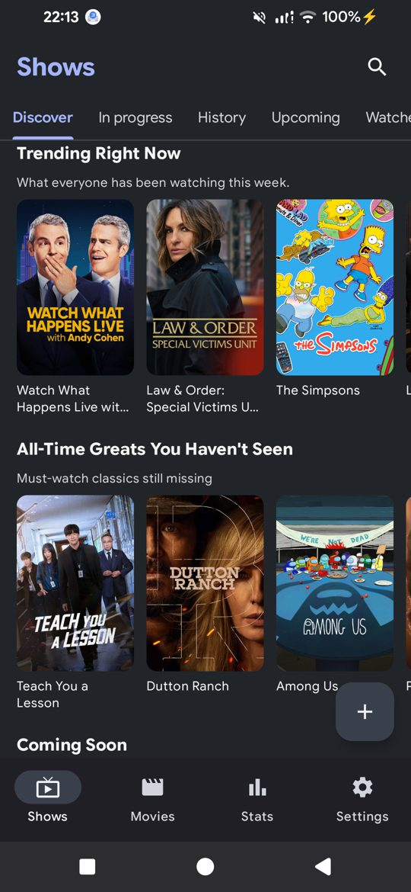
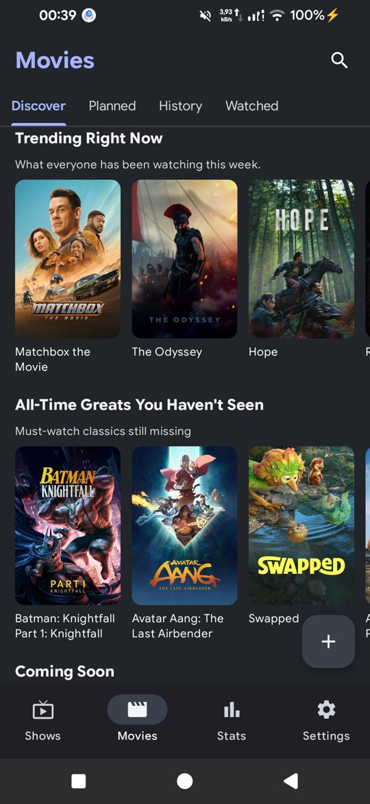
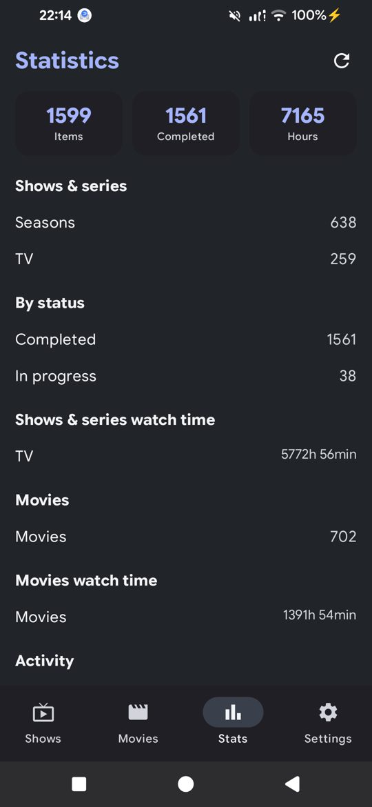
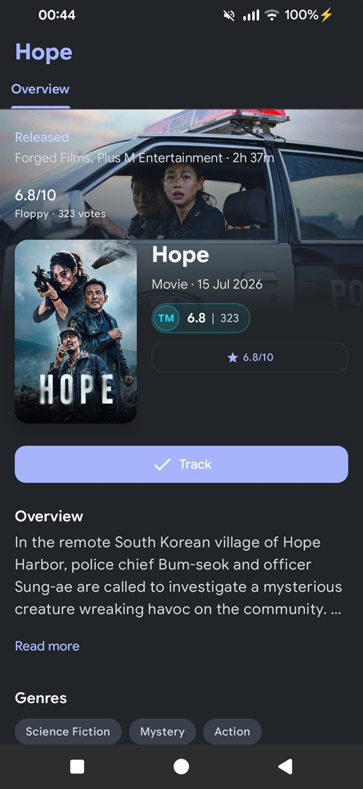
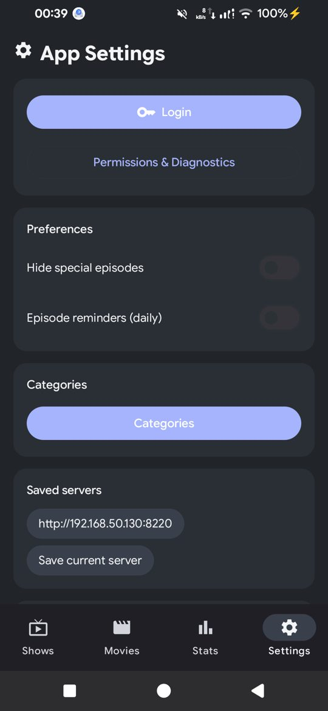

# Disketarr

Native Android client for the self-hosted **Floppy** media tracker.  
Built with Kotlin and Jetpack Compose against the Floppy REST API.

## Features

- Setup flow for Floppy base URL + API token (HTTP/HTTPS, LAN/Tailscale friendly)
- Search across movies, TV, anime, manga, comics, games, books, music, podcasts, board games
- List and grid result layouts with pagination
- Media details:
  - Track / untrack
  - Mark watched / unmark
  - Rating (0.0–10.0 slider)
  - Season & episode progress for shows
  - Per-series reminder bell
- Browse tabs: Discover, Planned, In progress, History, Upcoming, Watched
- History loads 30 items initially for faster first paint
- Saved server profiles for quick switching
- Offline cache (Room) for previously viewed pages
- Daily upcoming-episode reminders (WorkManager) with configurable lead time
- Deep links: `disketarr://details/{source}/{type}/{id}[?library=anime]`
- Home-screen widget with upcoming episodes (scrollable list)
- Statistics split by Shows/Series and Movies
- Categories filter (Movies/TV/Anime) to show/hide bottom tabs
- Library aware: a title tracked in Floppy's TV library shows in the Shows tab, one tracked in its Anime library in the Anime tab - the app asks Floppy which library a title is in rather than guessing
- The Anime tab follows Floppy's *anime library mode*: when the anime are filed in the TV library, there is no Anime library to show and the tab disappears
- Search recents + debounced typing
- Multiple themes (Blue, Purple, Ocean, Forest, Light) following system dark mode

## Screenshots

| Shows | Movies | Statistics |
| --- | --- | --- |
|  |  |  |

| Details | Settings |
| --- | --- |
|  |  |

## Tech Stack

- Kotlin + Jetpack Compose (Material 3)
- Hilt (DI), Navigation Compose
- Retrofit + OkHttp + Moshi
- Room (offline cache)
- Coil (images)
- WorkManager (reminders)
- EncryptedSharedPreferences (secure token storage)

## Requirements

- Android Studio (latest stable)
- Android SDK (compileSdk 35)
- Min SDK 26+
- A running Floppy instance and an App token (see below)

## API token permissions

The app talks to Floppy's REST API, so the token needs a few scopes. Create one
under **Floppy → Settings → Integrations → App tokens**, and tick exactly these:

| Scope | What the app uses it for |
| --- | --- |
| `catalog:read` | Search and the Discover rows |
| `lists:read` | The list of your Floppy lists, for "add to list" |
| `lists:write` | Adding a title to one of your lists |
| `statistics:read` | The Statistics tab |
| `user:read` | Reading Floppy's *anime library mode*, which decides whether the app shows an Anime tab |
| `watchlist:read` | The library: the Shows/Movies/Anime tabs, tracked-media lists, details, seasons and episodes, history, and the calendar behind the Upcoming tab |
| `watchlist:write` | Tracking and untracking a title, marking an episode watched or unwatched, and rating |

Floppy's default **Tracking** preset only covers `watchlist:read/write` and
`catalog:read`. The other four have to be ticked as well, or the matching part
of the app stays empty - no lists to add to, no statistics, and the Anime tab
may not match Floppy's setting.

Two things to know:

- A missing scope shows up as **HTTP 403**, not as a connection error.
  **Settings → Permissions & Diagnostics** probes every route the app uses and
  prints the scope it needs, so a 403 there points at the scope to add.
- `user:read` is the one that is easy to forget. Without it the app cannot see
  whether your anime live in the TV or in the Anime library, and it falls back to
  what it last knew.

The token is sent as `Authorization: Bearer <token>` and `X-API-Key: <token>`, and
is stored in EncryptedSharedPreferences on the device.

## Getting Started

1. Open the project in Android Studio and sync Gradle.
2. Build & run on an emulator or device.
3. Enter your Floppy base URL and API token in **Settings → Login**.
4. Save & test the connection.
5. If something is empty, open **Settings → Permissions & Diagnostics** and look
   for a 403 - it names the scope the token is missing.

## Build

```bash
./gradlew :app:compileDebugKotlin
./gradlew :app:assembleDebug
./gradlew :app:testDebugUnitTest
./gradlew :app:assembleRelease
```

## Releases

Pushing a tag starting with `v` (e.g. `v0.3.0`) triggers the GitHub Actions release
workflow, which builds the release APK and attaches it to a GitHub Release.

### Release signing

The APK must be signed with a **stable key**: Android only accepts an update
when it carries the same certificate as the installed app, so a key that
changes per release makes every new version uninstallable over the old one
("App not installed as package conflicts with an existing package").

The release key lives outside the repository, in the repository secrets:

| Secret | Value |
| --- | --- |
| `RELEASE_STORE_BASE64` | `base64 -w0 release.jks` |
| `RELEASE_STORE_PASSWORD` | The keystore password |
| `RELEASE_KEY_ALIAS` | The key alias, e.g. `disketarr` |
| `RELEASE_KEY_PASSWORD` | The key password |

Without them the workflow falls back to the *debug* key of the runner, which
changes whenever the runner image is refreshed - so the first release with a
real key needs a one-time uninstall on every device.

To build a signed release locally, put the same values in a git-ignored
`keystore.properties` and in the environment (`RELEASE_STORE_FILE`,
`RELEASE_STORE_PASSWORD`, `RELEASE_KEY_ALIAS`, `RELEASE_KEY_PASSWORD`).

**Keep `release.jks` and its passwords somewhere safe** (a password manager):
without them the app can never be updated in place again.

## Project Structure

- `app/src/main/java/io/github/catadoxy/disketarr/ui` — screens, navigation, theme
- `app/src/main/java/io/github/catadoxy/disketarr/viewmodel` — ViewModels and UI state
- `app/src/main/java/io/github/catadoxy/disketarr/data` — models, API client, cache, settings
- `app/src/main/java/io/github/catadoxy/disketarr/di` — Hilt modules
- `app/src/main/java/io/github/catadoxy/disketarr/workers` — WorkManager tasks
- `app/src/test/java/...` — unit tests

## Notes

- Cleartext HTTP is enabled for self-hosted instances without TLS (see `network_security_config.xml`).
- Base URLs without a scheme default to `http://` for LAN/loopback addresses and `https://` otherwise.
- If an external auth layer (Authelia/SSO) fronts Floppy, ensure `/api/v1/*` is reachable by mobile clients.
- Settings includes saved server profiles, category filters, reminder lead time, and a permissions/diagnostics probe.
- Floppy files a tracked title in one *library* (`tv`, `anime`, `movie` or `season`), and the same title can be in more than one of them. The app addresses a title by its library, so a title tracked in the TV library shows up in the Shows tab and the same title in the Anime library in the Anime tab. Which library the anime belong to is Floppy's `anime_library_mode` setting, and the app follows it.
- The app asks Floppy for a library rather than filtering the answer: `media_type=tv` is the TV library, `media_type=anime` the Anime one. The anime move between the two when the mode changes, and a title's own library field does not follow, so the list - not the field - is what says where a title belongs. The cached pages are keyed by the mode and dropped when it changes.
- The widget's *Shows* list reads the TV library, the Anime library or both - the **Source** setting - and its sort can run in either direction. A show whose aired episodes are all watched is left out while more are still to come. A refresh that cannot reach Floppy keeps the last list that loaded, so the widget does not blank out. Marking an episode watched from the widget writes into the library the row came from.